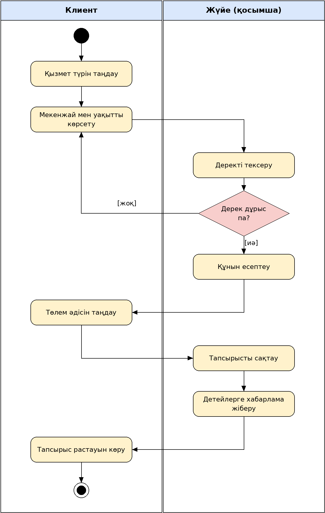

# Кез келген орынға барып қызмет көрсететін автодетейлингке тапсырыс беруге арналған мобильді қосымша

Автор: Қапар Қайсар, [топ]

## Мәселе
Автодетейлинг қызметін алу үшін клиент көлігін сервиске апарып, кезекте күтуі керек, бұл көп уақыт алады. Жоба клиентке қолайлы жерге (үйге, жұмысқа, тұрақа) детейлер шақыруға мүмкіндік беретін мобильді қосымша жасайды. Қосымша автокөлік иелеріне және детейлинг шеберлеріне керек.

## Акторлар
- Клиент
- Детейлер (шебер)
- Әкімші

## Талаптар
### Функционалдық
1. Жүйе клиентке қызмет түрін таңдауға мүмкіндік беруі керек
2. Жүйе клиенттің орналасқан жерін картадан көрсетуге мүмкіндік беруі керек

### Функционалдық емес
1. ...

## Диаграммалар
### 1. Use Case

### 2. Class

### 3. Activity: Автодетейлингке тапсырыс беру

### 4. Sequence: Автодетейлингке тапсырыс беру

