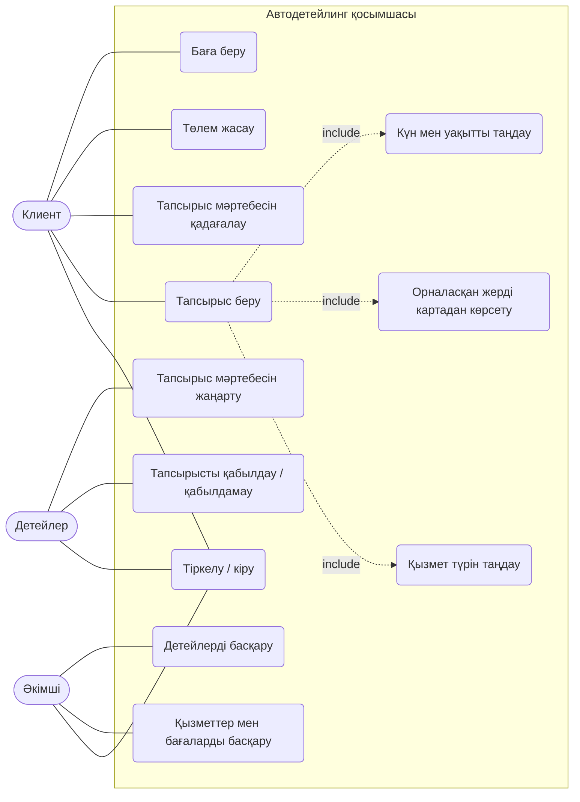
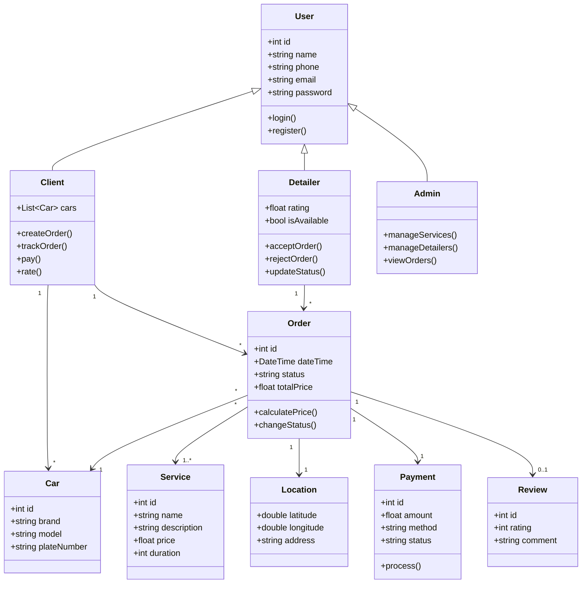
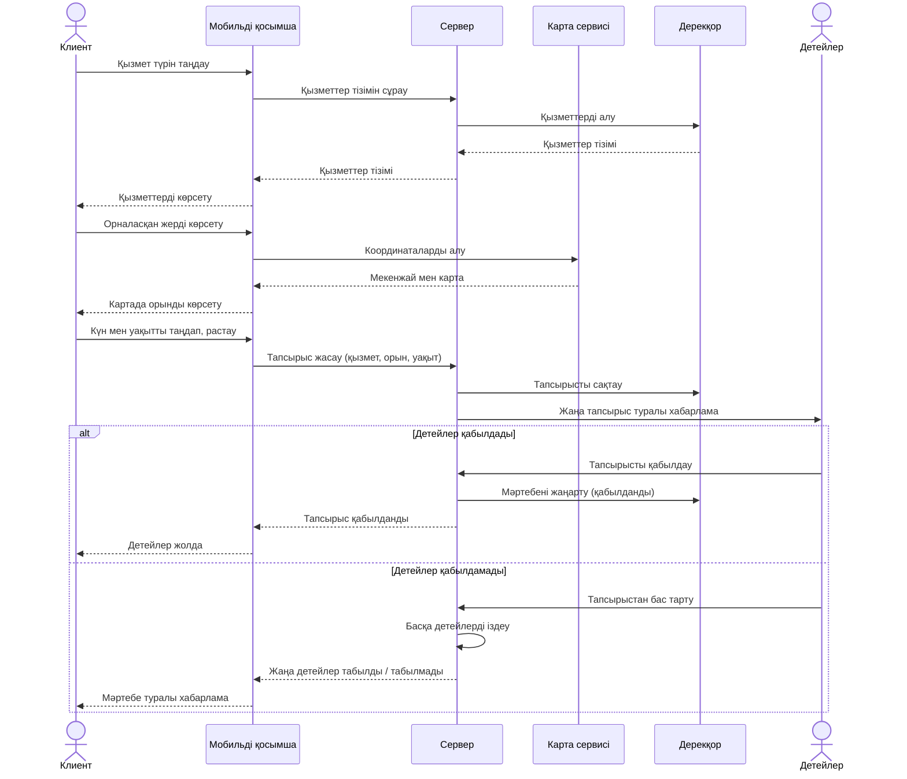

# Кез келген орынға барып қызмет көрсететін автодетейлингке тапсырыс беруге арналған мобильді қосымша

**Автор:** Қапар Қайсар, ВТ(КИ)к-24-1а

## Мәселе

Автодетейлинг қызметін алу үшін клиент көлігін сервиске апарып, кезекте күтуі керек, бұл көп уақыт алады. Жоба клиентке қолайлы жерге (үйге, жұмысқа, тұрақа) детейлер шақыруға мүмкіндік беретін мобильді қосымша жасайды. Қосымша автокөлік иелеріне және детейлинг шеберлеріне керек.

## Акторлар

* **Клиент** – қызметке тапсырыс беретін автокөлік иесі
* **Детейлер (шебер)** – тапсырысты қабылдап, орындайтын маман
* **Әкімші** – қызметтерді, шеберлерді және тапсырыстарды басқаратын қызметкер

## Талаптар

### Функционалдық

1. Жүйе клиентке қызмет түрін таңдауға мүмкіндік беруі керек
2. Жүйе клиенттің орналасқан жерін картадан көрсетуге мүмкіндік беруі керек
3. Жүйе клиентке тіркелуге және жүйеге кіруге мүмкіндік беруі керек
4. Жүйе клиентке қызмет көрсету күні мен уақытын таңдауға мүмкіндік беруі керек
5. Жүйе детейлерге жаңа тапсырысты қабылдауға немесе қабылдамауға мүмкіндік беруі керек
6. Жүйе клиентке тапсырыс мәртебесін қадағалауға мүмкіндік беруі керек
7. Жүйе қызмет көрсетілгеннен кейін төлем жасауға және баға беруге мүмкіндік беруі керек
8. Жүйе әкімшіге қызметтер тізімін, бағаларды және детейлерді басқаруға мүмкіндік беруі керек

### Функционалдық емес

1. **Өнімділік:** қосымша экрандары 2 секундтан аспай ашылуы керек
2. **Қауіпсіздік:** пайдаланушы деректері (пароль, телефон, мекенжай) шифрланып сақталуы керек
3. **Қолайлылық:** клиент тапсырысты 5 қадамнан аспай рәсімдей алуы керек
4. **Сенімділік:** жүйенің жұмыс істеу уақыты кемінде 99% болуы керек
5. **Үйлесімділік:** қосымша Android және iOS құрылғыларында жұмыс істеуі керек
6. **Масштабталу:** жүйе бір мезгілде кемінде 100 пайдаланушыға қызмет көрсете алуы керек

## Диаграммалар

### 1. Use Case

### 2. Class

### 3. Activity: Автодетейлингке тапсырыс беру

### 4. Sequence: Автодетейлингке тапсырыс беру

